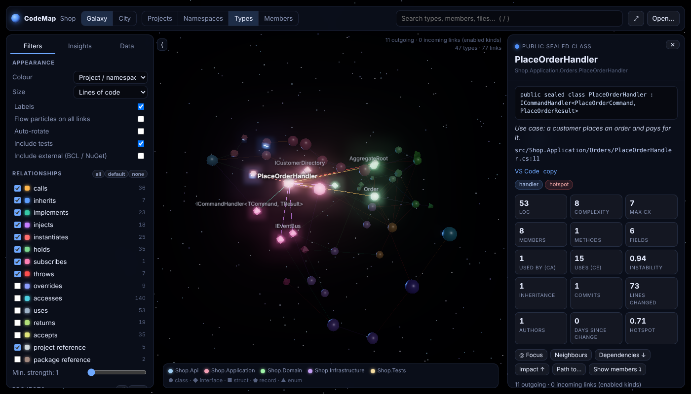
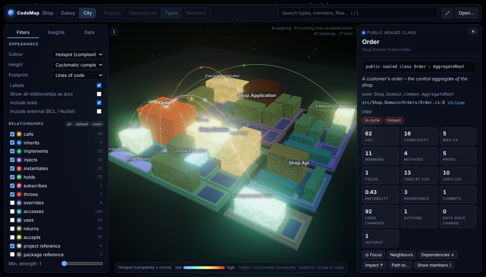
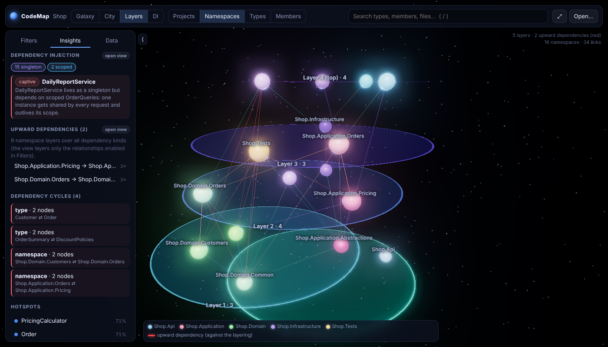
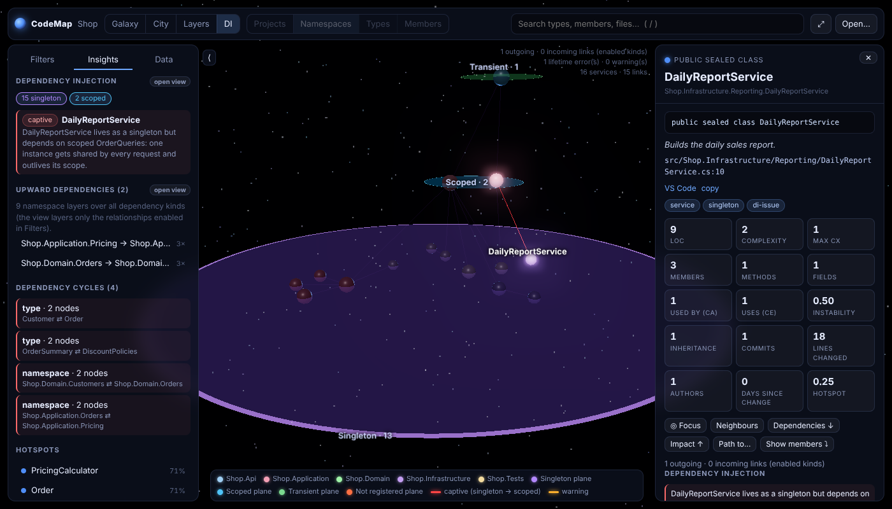
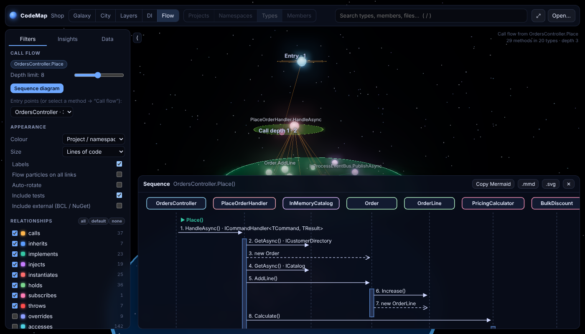
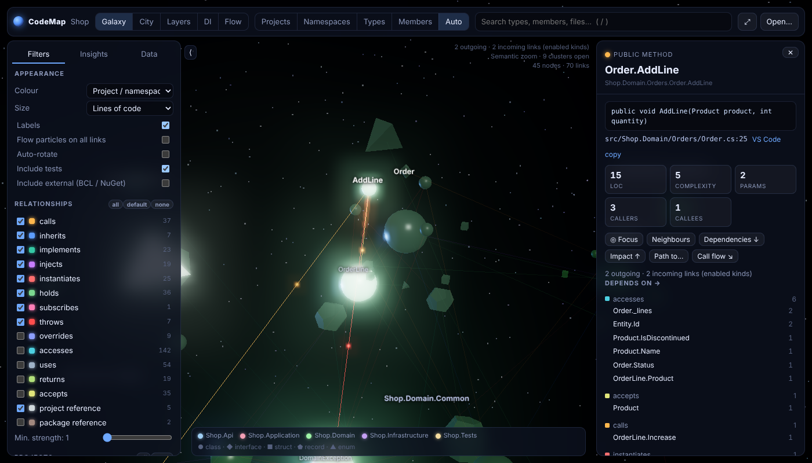

# CodeMap

**Mapa kodu dla projektów C#**: analizator oparty na Roslynie, który zamienia solucję w graf powiązań
(klasy, interfejsy, metody, wywołania, dziedziczenie, wstrzykiwanie zależności…), oraz interaktywna
**mapa 3D** z czterema widokami: *Galaxy* (graf siłowy w przestrzeni), *City* (miasto kodu, w którym typy są budynkami),
*Layers* (warstwy architektury wyliczone z kodu), *DI* (kontener zależności z czasami życia usług)
i *Flow* (przepływ wywołań od punktu wejścia, z diagramem sekwencji).

```
codemap MySolution.sln            →  MySolution.codemap.json   (graf: format do dalszego przetwarzania)
                                     MySolution.html           (interaktywna mapa 3D, działa offline)
                                     MySolution.md             (raport: warstwy, DI, cykle, hotspoty, martwy kod…)
```

| Galaxy: typy jako gwiazdy, projekty jako układy słoneczne | City: wysokość = złożoność, kolor = hotspot |
|---|---|
|  |  |
| **Layers: zależności w górę (czerwone) łamią warstwy** | **DI: singleton trzymający usługę scoped (captive dependency)** |
|  |  |
| **Flow: przepływ wywołań od akcji kontrolera, z diagramem sekwencji** | **Auto: zoom semantyczny, typ rozwinięty w składowe** |
|  |  |

## Szybki start

### Gotowy program (bez instalowania czegokolwiek)

Z zakładki [Releases](https://github.com/tomeqs/CodeMap/releases) pobierz plik dla swojego systemu,
rozpakuj go i uruchom `codemap` (na Windows wystarczy dwuklik na `codemap.exe`). Otworzy się przeglądarka z ekranem wyboru projektu.

| System | Plik |
|---|---|
| Windows (Intel/AMD, ARM) | `codemap-<wersja>-win-x64.zip`, `…-win-arm64.zip` |
| macOS (Apple Silicon, Intel) | `codemap-<wersja>-osx-arm64.tar.gz`, `…-osx-x64.tar.gz` |
| Linux | `codemap-<wersja>-linux-x64.tar.gz`, `…-linux-arm64.tar.gz` |

To jeden plik wykonywalny (około 50 MB) z wbudowanym środowiskiem .NET, więc działa bez .NET. Jeśli .NET SDK
jest zainstalowany, `codemap` i tak go znajdzie i użyje jego bibliotek (najnowszej wersji) do rozwiązywania
typów frameworka. `codemap --version` pokazuje, skąd je bierze.

* **Windows**: plik nie jest podpisany, więc SmartScreen może pokazać ostrzeżenie (*Więcej informacji → Uruchom mimo to*).
* **macOS**: po pobraniu z przeglądarki zdejmij kwarantannę: `xattr -d com.apple.quarantine ./codemap`.
* Warto dodać folder z programem do `PATH`, żeby `codemap` działał z każdego terminala i w skrótach IDE.

### Jako narzędzie .NET

Wymagany jest .NET SDK 8 lub nowszy. Node.js jest potrzebny tylko do przebudowania viewera.

```bash
# z pliku .nupkg z Releases albo zbudowanego lokalnie
dotnet pack src/CodeMap.Cli -o nupkg
dotnet tool install -g CodeMap.Tool --add-source nupkg

codemap            # otwiera aplikację w przeglądarce
```

### Rozszerzenie VS Code

Mapa otwiera się w karcie edytora, a z kodu do mapy i z powrotem przechodzisz jednym kliknięciem:

* **CodeMap: Open Code Map** z palety poleceń albo prawym przyciskiem na `.sln` / `.slnx` / `.csproj` / folderze w Explorerze;
* **Open** w panelu szczegółów (albo dwuklik na metodzie) otwiera kod w edytorze obok;
* **Show in Code Map** (`Ctrl+Alt+M`) zaznacza na mapie metodę albo klasę spod kursora;
* **Show Call Flow** (menu kontekstowe edytora) pokazuje przepływ wywołań i diagram sekwencji metody spod kursora;
* po zapisaniu pliku `.cs` mapa sama się odświeża i nie gubi kamery ani zaznaczenia;
* Mermaid i JSON zapisujesz przez okno zapisu VS Code.

Instalacja: plik `codemap-<wersja>.vsix` z [Releases](https://github.com/tomeqs/CodeMap/releases), potem
*Extensions → … → Install from VSIX…* albo `code --install-extension codemap-0.2.0.vsix`. Rozszerzenie ma w sobie
analizator (wymaga .NET SDK 8+, który i tak masz do C#). Bez .NET ustaw `codemap.analyzerPath` na samodzielny plik `codemap`.
Kod rozszerzenia jest w [`vscode/`](vscode/).

### Wydawanie nowej wersji

Workflow [`.github/workflows/release.yml`](.github/workflows/release.yml) uruchamia testy i buduje programy
dla 6 platform. Dla każdej sprawdza, czy program uruchamia się i analizuje przykładową solucję, a do tego pakuje narzędzie .NET
i rozszerzenie VS Code (`.vsix`).

```bash
git tag v0.2.0 && git push origin v0.2.0     # GitHub release z plikami i sumami SHA256
```

Workflow można też uruchomić ręcznie (*Actions → Release → Run workflow*). Z podaną wersją (np. `0.2.0`) sam tworzy tag `v0.2.0`
i release. Bez wersji pliki trafiają tylko do artefaktów.
Opcjonalne sekrety repozytorium publikują dalej: `NUGET_API_KEY` wysyła narzędzie do nuget.org
(`dotnet tool install -g CodeMap.Tool`), `VSCE_PAT` rozszerzenie do VS Code Marketplace, a `OVSX_PAT` do Open VSX (VSCodium, Cursor). Lokalnie program dla wybranej platformy buduje:

```bash
dotnet publish src/CodeMap.Cli -c Release -r win-x64 -o dist/win-x64     # albo linux-x64, osx-arm64…
```

### Aplikacja w przeglądarce (najwygodniej)

`codemap` bez argumentów uruchamia lokalny serwer (tylko `127.0.0.1`) i otwiera przeglądarkę
z ekranem wyboru projektu:

* **przeglądarka folderów**: od razu widać, gdzie leżą solucje (◆) i projekty (●); dwuklik analizuje;
* **klonowanie z Gita**: wklej URL repozytorium, a CodeMap sklonuje je do `~/.codemap/repos` i sam znajdzie solucję;
* **ostatnie projekty**: zapamiętane mapy otwierają się natychmiast z cache (`~/.codemap/cache`);
* **postęp analizy na żywo**, z możliwością anulowania;
* **↻** na mapie: ponowna analiza bez utraty kamery, filtrów i zaznaczenia;
* **Live**: mapa sama się odświeża, gdy zapiszesz plik `.cs`/`.csproj`, a toast pokazuje, ile typów przybyło lub ubyło.

```bash
codemap                                   # ekran wyboru projektu
codemap ui path/to/MySolution.sln         # od razu analizuje wskazaną solucję
codemap ui . --watch                      # bieżący folder + odświeżanie na żywo
codemap ui --port 6000 --no-open          # inny port, bez otwierania przeglądarki
```

Serwer przyjmuje połączenia tylko z `127.0.0.1`, odrzuca obce nagłówki `Host` (DNS rebinding),
a każde wywołanie API wymaga tokenu sesji, który jest wstrzykiwany tylko do strony serwowanej
przez `codemap`. Inne strony otwarte w przeglądarce nie mogą więc z niego korzystać.

### Skrót w IDE

**Visual Studio**: *Tools → External Tools… → Add*
* Command: `%USERPROFILE%\.dotnet\tools\codemap.exe` (albo ścieżka do pobranego `codemap.exe`)
* Arguments: `ui "$(SolutionDir)$(SolutionFileName)" --watch`

**JetBrains Rider**: *Settings → Tools → External Tools*, Program `codemap`, Arguments `ui "$SolutionPath$" --watch`.

**VS Code**: `.vscode/tasks.json`
```json
{
  "version": "2.0.0",
  "tasks": [{ "label": "CodeMap", "type": "shell", "command": "codemap ui \"${workspaceFolder}\" --watch", "isBackground": true, "problemMatcher": [] }]
}
```

### Generowanie plików (CI, raporty)

```bash
# analiza solucji (.sln / .slnx / .slnf), projektu (.csproj), pliku .cs albo dowolnego folderu
codemap path/to/MySolution.sln -o out --open
# bez instalacji: dotnet run --project src/CodeMap.Cli -- path/to/MySolution.sln -o out
```

Otwórz `out/MySolution.html` w przeglądarce. Plik jest samowystarczalny (viewer i dane w jednym pliku),
więc można go wysłać komuś mailem albo dołączyć do artefaktów CI.

Projekty **nie muszą być zbudowane**. CodeMap czyta `.csproj` bezpośrednio, a typy frameworka bierze
z zainstalowanego .NET. Jeśli wcześniej był `dotnet restore`, typy z paczek NuGet też są rozpoznawane
(przez `obj/project.assets.json`).

### Opcje CLI

| Opcja | Znaczenie |
|---|---|
| `-o, --output <dir>` | katalog wyjściowy (domyślnie `codemap-out`) |
| `-f, --format <list>` | `json,html,md,dgml,graphml,cypher` lub `all` (domyślnie `json,html,md`) |
| `--external` | dołącz typy z BCL / NuGet, od których zależy kod (np. `DbContext`, `ILogger<T>`) |
| `--types-only` | usuń węzły składowych (metody, pola…), a ich relacje podnieś na poziom typów; dużo mniejszy plik |
| `--no-tests` | pomiń projekty testowe |
| `--generated` | analizuj też kod generowany (`*.g.cs`, `*.Designer.cs`, `<auto-generated>`) |
| `--no-git` / `--git-since "1 year ago"` | historia gita: churn, autorzy, hotspoty |
| `--indent` | sformatowany JSON |
| `--open` | otwórz mapę w przeglądarce |
| `--port <n>` / `--no-open` / `--watch` | opcje aplikacji (`codemap` / `codemap ui`) |
| `codemap export graph.codemap.json -f dgml,cypher` | konwersja istniejącego grafu na inne formaty |

## Co jest najciekawsze w mapie kodu

Sama lista klas niewiele mówi. Wartość mapy bierze się z **relacji** i z tego, co da się z nich policzyć.

### 1. Relacje: 19 rodzajów krawędzi, z wagą (liczbą wystąpień)

| Rodzaj | Przykład w C# | Po co |
|---|---|---|
| `inherits`, `implements` | `class Order : AggregateRoot, IAuditable` | hierarchie, kontrakty |
| `implements` (metoda → metoda interfejsu) | `HandleAsync` → `ICommandHandler.HandleAsync` | nawigacja przez abstrakcje |
| `overrides` | `override decimal DiscountFor(...)` | polimorfizm |
| `calls` | `_repo.AddAsync(order)` | graf wywołań metoda → metoda |
| `instantiates` | `new OrderLine(...)` | kto tworzy obiekty (fabryki, `new` w złych miejscach) |
| `injects` | `public Handler(IOrderRepository repo)` / primary ctor | **graf zależności DI**, czyli prawdziwa architektura aplikacji |
| `holds` | `private readonly List<Order> _orders` | kompozycja i agregacja |
| `accesses` | `order.Total`, `_clock.Now` | odczyt/zapis pól i właściwości (spójność klas) |
| `subscribes` | `bus.Published += OnPublished` | ukryte przepływy przez zdarzenia |
| `throws`, `catches` | `throw new DomainException(..)` | przepływ wyjątków |
| `returns`, `accepts` | sygnatury metod | kontrakty API |
| `extends` | `static IServiceCollection AddShop(this IServiceCollection s)` | metody rozszerzające |
| `decoratedWith` | `[ApiController]`, `[Fact]` | atrybuty |
| `uses` | `typeof(X)`, wywołania statyczne, `is X` | pozostałe zależności |
| `projectReference`, `packageReference` | `.csproj` | architektura na poziomie projektów |
| `changesWith` | dwa pliki zmieniane w tych samych commitach | **ukryte powiązania** z historii gita (to nie jest zależność w kodzie) |

### 2. Metryki (na każdym poziomie: projekt → namespace → typ → składowa)

* **rozmiar**: LOC, liczba składowych, metod, pól…
* **złożoność cyklomatyczna** każdej metody i suma dla typu (WMC)
* **coupling**: `Ca` (ile typów mnie używa), `Ce` (ilu typów ja używam), **instability** `Ce/(Ca+Ce)`
* **abstractness** i **odległość od main sequence** (Robert C. Martin) dla namespace’ów i projektów,
  dzięki czemu widać „strefę bólu” (konkretne i bardzo używane) i „strefę bezużyteczności”
* **DIT / NOC**: głębokość dziedziczenia i liczba podklas
* **fan-in / fan-out** metod

### 3. Wnioski, których nie widać w IDE

* **Hotspoty** = złożoność × częstotliwość zmian z gita. Kod, który jest skomplikowany *i* ciągle
  zmieniany, to najlepsi kandydaci do refaktoryzacji (podejście Adama Tornhilla, „Your Code as a Crime Scene”).
* **Cykle zależności** (Tarjan SCC) między typami, namespace’ami i projektami.
* **Warstwy architektury** wyliczane z samego kodu: każdy namespace i projekt dostaje numer warstwy
  (zależności mają wskazywać w dół), a **zależności „w górę”** to minimalny zestaw krawędzi, których
  usunięcie rozbija wszystkie cykle, czyli najlepsze miejsca do cięcia.
* **Ukryte powiązania z gita** (change coupling): typy, które ciągle zmieniają się razem
  (wspólne commity / średnia liczba zmian), a nie mają między sobą żadnej zależności w kodzie.
  Zwykle to zduplikowana logika, ukryty kontrakt (np. format JSON, nazwa kolejki) albo para klient–serwer.
* **Mapa DI**: rejestracje z `IServiceCollection` (`AddSingleton/Scoped/Transient`, `TryAdd*`, `Keyed*`,
  `AddHostedService`, `AddDbContext`, `AddHttpClient<T>`, fabryki i przekierowania), czas życia każdej usługi,
  a na tej podstawie **captive dependencies** (singleton trzymający usługę scoped albo transient)
  i **brakujące rejestracje** (konstruktor potrzebuje czegoś, czego nikt nie rejestruje).
  Kontrolery, huby i middleware aktywowane przez framework też są brane pod uwagę.
* **Kandydaci na martwy kod**: niepubliczne symbole, do których nic się nie odwołuje.
* **Role** rozpoznawane heurystycznie: controller, DbContext, repository, handler (MediatR/CQRS),
  hosted service, middleware, test, options, DTO, extensions…
* **Analiza wpływu** (w viewerze): co się zepsuje, jeśli zmienię ten typ (przechodnie zależności wsteczne),
  a także **ścieżka** między dwoma dowolnymi elementami („jak kontroler dochodzi do bazy?”).

## Format danych

Głównym formatem jest **CodeMap JSON** (`*.codemap.json`): czytelny dla ludzi, prosty do wczytania
w dowolnym języku i dla LLM-ów. Węzły tworzą drzewo zawierania (`parent`), krawędzie opisują resztę relacji.
Identyfikatory to standardowe *documentation comment IDs* z C# (`T:Shop.Domain.Orders.Order`,
`M:Shop.Domain.Orders.Order.AddLine(Shop.Domain.Catalog.Product,System.Int32)`), więc są stabilne
między uruchomieniami i zgodne z tym, czego używają XML docs i Roslyn.

```json
{
  "format": "codemap", "version": "1.0",
  "nodes": [
    { "id": "T:Shop.Domain.Orders.Order", "kind": "class", "name": "Order",
      "parent": "namespace:Shop.Domain/Shop.Domain.Orders", "project": "project:Shop.Domain",
      "signature": "public sealed class Order : AggregateRoot",
      "location": { "file": "src/Shop.Domain/Orders/Order.cs", "line": 8, "endLine": 69 },
      "tags": ["in-cycle", "hotspot"],
      "metrics": { "loc": 62, "complexity": 16, "ca": 13, "ce": 10, "instability": 0.435 } }
  ],
  "edges": [
    { "source": "M:Shop.Application.Orders.PlaceOrderHandler.HandleAsync(...)",
      "target": "M:Shop.Domain.Orders.Order.Place", "kind": "calls", "weight": 1 }
  ],
  "analysis": { "cycles": [...], "hotspots": [...], "layers": [...], "changeCoupling": [...], "di": {...} }
}
```

Pełna specyfikacja: [docs/format.md](docs/format.md), JSON Schema: [docs/codemap.schema.json](docs/codemap.schema.json).

Formaty dodatkowe:

* **DGML**: otwiera się natywnie w Visual Studio (Code Map / DGML editor), grupy projekt → namespace → typ.
* **GraphML**: Gephi, yEd, Cytoscape, NetworkX.
* **Cypher**: import do Neo4j/Memgraph, potem zapytania typu
  `MATCH p=(c:Class {name:'OrdersController'})-[:CALLS|INJECTS*1..6]->(r:Interface) RETURN p`.
* **Markdown**: raport z przeglądem architektury, który można wkleić do PR-a, wiki albo promptu.

## Mapa 3D

* **Galaxy**: graf siłowy 3D. Projekty to „układy słoneczne”, namespace’y skupiska, typy gwiazdy.
  Kształt oznacza rodzaj (● klasa, ◆ interfejs, ■ struct, ⬟ record, ▲ enum), rozmiar wybraną metrykę,
  a kolor projekt, rodzaj, rolę albo dowolną metrykę (skala *turbo*). Po zaznaczeniu elementu
  cząsteczki płyną wzdłuż krawędzi w kierunku zależności.
* **City**: miasto kodu. Dzielnice to projekty, kwartały namespace’y, budynki typy.
  Powierzchnia odpowiada LOC, wysokość złożoności (lub innej metryce), a kolor np. hotspotom.
  Relacje rysowane są jako łuki nad miastem.
* **Layers**: węzły leżą na poziomych płaszczyznach warstw wyliczonych z widocznych relacji
  (projekty to kolumny przechodzące przez warstwy). Zależności wskazujące w górę są czerwone.
* **DI**: typy budowane przez kontener na płaszczyznach *Singleton / Scoped / Transient / Not registered*.
  Zdrowa zależność wskazuje w dół albo w bok (do czegoś, co żyje co najmniej tak długo),
  captive dependency jest czerwona, a brakująca rejestracja pomarańczowa.
* **Flow**: co się dzieje, gdy wywołasz akcję kontrolera, handler albo `ExecuteAsync` usługi w tle.
  Wywołania są śledzone w kolejności z kodu, przez interfejsy aż do implementacji, którą wstrzyknie kontener DI
  (`IEnumerable<T>` → wszystkie). Górna płaszczyzna to punkt wejścia, a każda niższa to jedno wywołanie głębiej.
  **Diagram sekwencji** pokazuje ten sam przepływ jako uczestników (typy) i komunikaty (`alt` dla kilku możliwych implementacji, `loop` dla `IEnumerable<T>`).
  Można go skopiować jako **Mermaid** (wklejasz do GitHuba, GitLaba, Notion albo dokumentacji) lub pobrać jako `.mmd` / `.svg`.
  Punkt wejścia wybierasz w Insights (*Entry points*), na liście w widoku albo przyciskiem *Call flow ↘* przy dowolnej metodzie.
* **Auto (zoom semantyczny)**: zamiast przełączać poziomy, po prostu lecisz kamerą. Z daleka namespace to jedna gwiazda
  w środku swoich typów. Gdy się zbliżysz, rozwija się w typy, a najbliższe typy w swoje składowe (metody, właściwości, pola).
  Po oddaleniu wszystko zwija się z powrotem. Układ liczony jest raz, więc mapa się nie przestawia, a wyszukiwarka sama doleci do składowej ukrytej w zwiniętym typie.
* Poziomy szczegółowości: **Projects / Namespaces / Types / Members** i drill-down dwuklikiem
  (projekt → namespace’y → typy → składowe, z „duchami” sąsiadów spoza zakresu).
* Panel szczegółów: sygnatura, dokumentacja XML, metryki, tagi, link *Open in VS Code*,
  relacje wychodzące i przychodzące pogrupowane według rodzaju, lista składowych.
* **Neighbours / Dependencies ↓ / Impact ↑ / Path to…** (albo Shift+klik na drugim elemencie).
* Zakładka **Insights**: punkty wejścia (kontrolery, handlery, usługi w tle, `Main`), problemy DI, zależności w górę, ukryte powiązania z gita, cykle, hotspoty,
  najbardziej złożone typy, najczęściej używane typy, możliwy martwy kod. Kliknięcie przenosi do właściwego widoku.
* Kolor **DI lifetime** w każdym widoku (namespace’y i projekty dostają dominujący czas życia swoich typów),
  a w panelu szczegółów sekcje *Dependency injection* i *Changes together with*.
* Filtry rodzajów relacji, projektów, testów, typów zewnętrznych, minimalnej siły powiązania.
* Wyszukiwarka (`/`), skróty: `1`–`4` poziom, `Z` zoom semantyczny, `G`/`C`/`L`/`D`/`E` widok (Galaxy, City, Layers, DI, Flow), `F` dopasuj, `Esc` wstecz.

Viewer można też otworzyć bez danych i przeciągnąć na niego dowolny plik `*.codemap.json`
albo użyć parametru `?data=url.json`.

### GPU

* Mapa rysuje przez **WebGPU**: Metal na macOS, Direct3D 12 na Windows, Vulkan na Linuksie.
  Gdy przeglądarka (albo VS Code) nie ma WebGPU, przechodzi na **WebGL 2**.
  Backend można wymusić w zakładce *Data* (*Graphics → Renderer*), parametrem `?renderer=webgpu|webgl`
  albo ustawieniem `codemap.renderer` w VS Code.
* Układ siłowy liczy się w **Web Workerze**, więc mapa i interfejs zostają płynne, a duży graf układa się wielokrotnie szybciej.
  Do 15 000 elementów na poziom; bez workera, na przykład gdy CSP go blokuje, wraca na główny wątek z limitem 7000.
* Pozycje elementów leżą w teksturze na GPU. Węzły, relacje (wstęgi o miękkich krawędziach, w City łuki)
  i płynące cząsteczki odczytują je w shaderach, więc ruch grafu to jedno przesłanie tekstury na klatkę,
  zamiast przepisywania macierzy i wierzchołków. Przy 20 000 elementów koszt CPU klatki spadł z 5 ms do 0,25 ms.
* Klatki rysowane są tylko wtedy, gdy coś się zmienia: ruch kamery, układanie grafu, animacja.
  Nieruchoma mapa nie zużywa GPU ani baterii. Cząsteczki i pulsowanie zaznaczenia zatrzymują się po 20 s bez ruchu myszy
  i przy systemowym *ogranicz ruch*.
* Natywne renderery (Metal / Direct3D 12 poza przeglądarką) to osobny temat: [tomeqs/CodeMap#6](https://github.com/tomeqs/CodeMap/issues/6).

## Struktura repozytorium

```
src/CodeMap.Core      analizator (Roslyn), model grafu, metryki, eksportery
  Loading/            .sln/.slnx/.slnf/.csproj → kompilacje Roslyn (bez MSBuild i bez budowania)
  Analysis/           deklaracje, walker referencji, metryki, cykle, warstwy, DI, git (churn, change coupling), tagi
  Export/             JSON, DGML, GraphML, Cypher, Markdown, HTML
src/CodeMap.Server    lokalna aplikacja: API (ASP.NET Core), przeglądarka folderów, klonowanie, cache, tryb live
src/CodeMap.Cli       narzędzie `codemap` (dotnet tool albo samodzielny plik wykonywalny), osadza zbudowany viewer
vscode/               rozszerzenie VS Code: mapa w webview, przejścia kod ↔ mapa, odświeżanie na żywo
viewer/               mapa 3D: Vite + three.js + d3-force-3d + d3-hierarchy, budowana do jednego pliku HTML
tests/CodeMap.Tests   testy xUnit analizatora i eksporterów
samples/Shop          przykładowa solucja (DDD, DI, zdarzenia, celowy cykl i martwy kod)
docs/                 specyfikacja formatu i JSON Schema
```

## Rozwój

```bash
dotnet test                                   # testy analizatora
cd viewer && npm install && npm run dev       # viewer z hot-reload: http://localhost:5173/?data=sample.codemap.json
npm run build                                 # buduje dist/index.html i kopiuje go do src/CodeMap.Cli/Assets/viewer.html
npm run test:smoke -- --renderers webgpu,webgl   # smoke testy zbudowanego viewera w headless Chromium (bez GPU)
npm run bench -- --sizes 1k,7k,20k            # benchmark na wygenerowanych grafach, porównanie z bench/baseline.json
```

Benchmark generuje syntetyczne solucje (`node bench/generate.mjs --types 100k`) i mierzy wczytanie, model,
czas ułożenia grafu, płynność orbity, liczbę klatek w bezczynności, picking i przejścia po grafie.
Bez `--headed` Chromium nie ma GPU (SwiftShader), więc liczby zależne od GPU mają sens tylko z `--headed` na prawdziwym komputerze.

Do trybu dev wrzuć dowolny wygenerowany graf do `viewer/public/sample.codemap.json`.
Żeby rozwijać ekran wyboru projektów, uruchom `CODEMAP_DEV=1 codemap ui --no-open` i otwórz
wypisany adres „Dev viewer” (Vite przekierowuje `/api` do serwera).
Zbudowany viewer (`src/CodeMap.Cli/Assets/viewer.html`) jest w repozytorium, żeby samo `dotnet run`
generowało HTML bez Node.js. Po zmianach w `viewer/` trzeba uruchomić `npm run build`.

### Jak to działa

1. `ProjectLoader` czyta solucję i pliki `.csproj` (z `Directory.Build.props`, `Compile Remove`,
   `ImplicitUsings`, `<Using>`, referencjami projektów i paczek).
2. `CompilationFactory` buduje kompilację Roslyn dla każdego projektu w kolejności topologicznej:
   referencje frameworka z działającego runtime’u albo, w samodzielnym pliku wykonywalnym, z zainstalowanego .NET
   lub z runtime’u wbudowanego w program (`FrameworkLocator`), plus ASP.NET Core / WindowsDesktop, gdy są potrzebne,
   paczki z `project.assets.json`, a projekty jako `CompilationReference`.
3. `TypeAnalyzer` + `ReferenceWalker` przechodzą równolegle drzewa składni: deklarują węzły i każdą
   referencję w kodzie rozwiązują przez model semantyczny na krawędź z odpowiednim rodzajem.
4. `GraphMetrics` liczy metryki, cykle i kandydatów na martwy kod, `Layering` warstwy i zależności w górę,
   `DependencyInjectionAnalysis` łączy rejestracje z konstruktorami, a `GitHistory` i `ChangeCouplingAnalysis`
   dokładają churn, hotspoty i ukryte powiązania.
5. Eksportery zapisują wynik; HTML to viewer z osadzonym JSON-em.

Analiza jest „best effort”: kod, który nie kompiluje się w izolacji (np. brak restore’u paczek),
nadal jest mapowany, a nierozwiązane symbole są po prostu pomijane.

## Pomysły na dalszy rozwój

* reguły architektoniczne (np. „Domain nie może zależeć od Infrastructure”) z naruszeniami zaznaczonymi na mapie
  (warstwy wyliczane automatycznie są dobrym punktem startowym)
* porównanie dwóch wersji grafu (diff architektury między commitami / w PR)
* tryb VR/WebXR dla widoku City
* własność kodu (autorzy z gita) jako kolor dzielnic
* serwer MCP, który odpowiada na pytania o architekturę na podstawie grafu
* rozszerzenie VS Code / Visual Studio z mapą w panelu edytora i przejściem do kodu jednym kliknięciem
