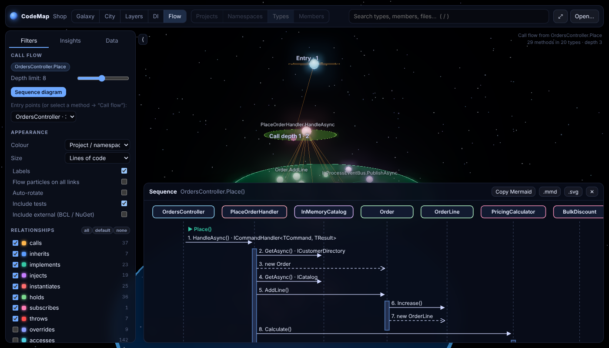

# CodeMap for VS Code

An interactive 3D map of your C# solution, inside VS Code and one click away from the code.

## What you get

- **Galaxy and City**: projects, namespaces and types laid out as a force graph or a code city. Size, height and colour show any metric (lines, complexity, coupling, git churn, hotspots).
- **Layers**: architecture layers computed from the code, with dependencies that point upwards in red.
- **DI**: services on singleton / scoped / transient planes. Captive dependencies and missing registrations are flagged.
- **Flow**: what a controller action, handler or background service calls, in source order and through interfaces to the implementation the container injects. Includes a **sequence diagram** you can copy as Mermaid.
- **Auto zoom**: fly into a namespace and it opens into its types, then into their members.
- **Insights**: cycles, hotspots, possibly unused code, hidden coupling from git history.

## From the map to the code and back

| | |
|---|---|
| **CodeMap: Open Code Map** | Command palette, or right-click a `.sln` / `.slnx` / `.csproj` / folder in the Explorer |
| **Open a symbol's code** | *Open* in the details panel, or double-click a method |
| **CodeMap: Show in Code Map** (`Ctrl+Alt+M`) | Selects the method or type under the cursor on the map |
| **CodeMap: Show Call Flow** | The call flow and sequence diagram of the method under the cursor (editor context menu) |
| **CodeMap: Choose Solution…** | Switch to another solution in the workspace |

The map updates itself when you save C# or project files; the camera and the selection stay where they were.

## Requirements

- **.NET SDK 8 or newer** (`dotnet` on PATH): the extension runs the CodeMap analyzer on it. You don't need to build or restore the solution, although restored projects give more complete results.
- Without .NET, set `codemap.analyzerPath` to the standalone `codemap` executable from the [releases](https://github.com/tomeqs/CodeMap/releases).

## Settings

| Setting | Default | |
|---|---|---|
| `codemap.liveUpdate` | `true` | Refresh the map when files are saved |
| `codemap.includeTests` | `true` | Include test projects |
| `codemap.includeExternal` | `false` | Include framework and NuGet types |
| `codemap.gitHistory` | `true` | Churn, hotspots and change coupling from git |
| `codemap.renderer` | `auto` | Graphics API of the map: WebGPU where VS Code supports it, otherwise WebGL 2 (`webgpu` / `webgl` to force one) |
| `codemap.analyzerPath` | | Use another analyzer (a `codemap` executable or `codemap.dll`) |
| `codemap.dotnetPath` | `dotnet` | The dotnet that runs the bundled analyzer |

The analyzer only reads the code: it does not build it or run MSBuild. Nothing leaves your machine, and the map has no network access.
